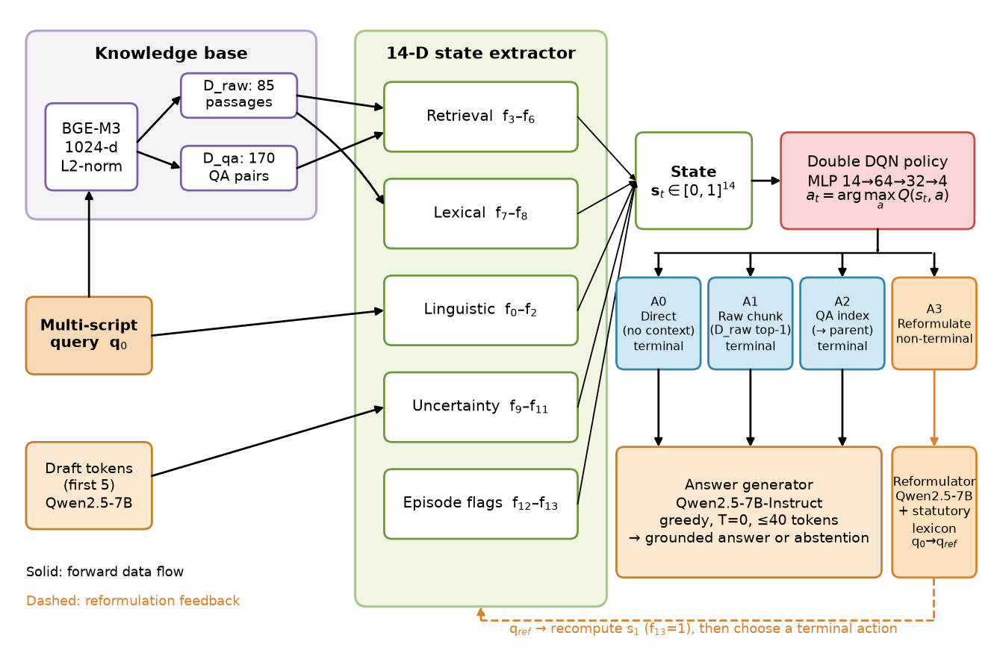
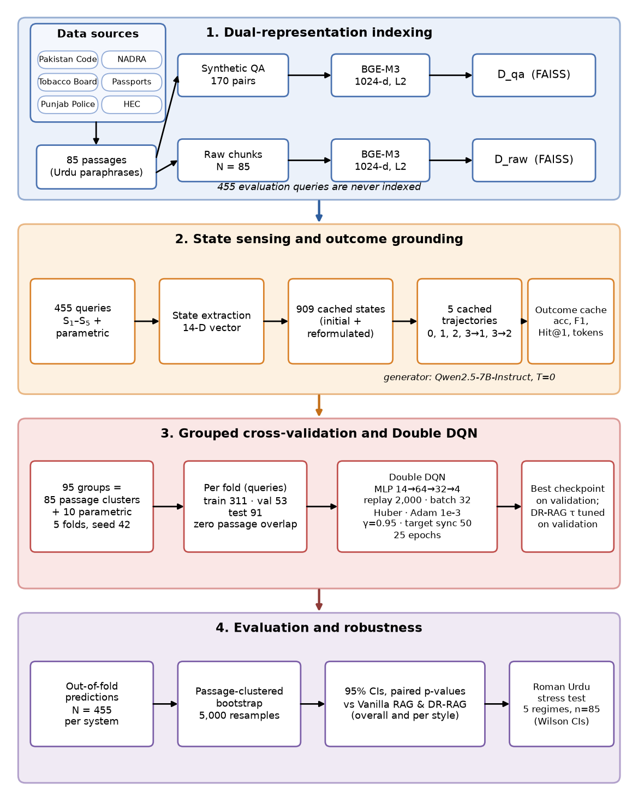
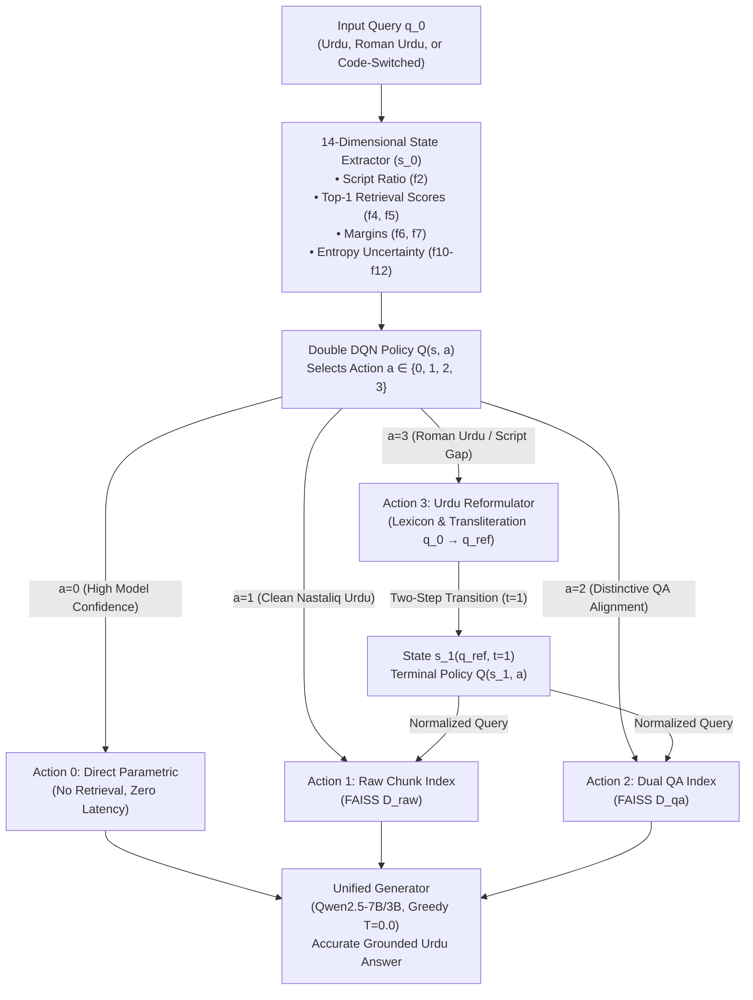

# Urdu-DynRAG: Dynamic Routing and Query Reformulation for Cross-Script Retrieval: Benchmarking Roman Urdu on Official Pakistani Documents

[](https://www.python.org/downloads/)
[](https://pytorch.org/)
[](LICENSE)

> **Official Implementation** for the paper:  
> *"Urdu-DynRAG: A Dynamic Routing and Query Reformulation Framework for Cross-Script Retrieval: Benchmarking Roman Urdu on Official Pakistani Documents"*.

---

## 📌 Executive Summary

Modern dense retrieval models (such as BGE-M3 and Multilingual-E5) achieve high accuracy on standard Nastaliq Urdu ($S_1: 98.8\%$ Hit@1), but suffer **severe retrieval degradation** on mixed-script, informal, and Latin-transliterated text:
- **Clean Nastaliq Urdu ($S_1$)**: $98.8\%$ Hit@1
- **Conversational / Elliptical ($S_2$)**: $92.9\%$ Hit@1
- **Code-Switched English-Urdu ($S_3$)**: $97.6\%$ Hit@1
- **Roman Urdu ($S_4$)**: Drops precipitously to **$75.3\%$ Hit@1** ($-23.5\%$ retrieval gap) due to subword token fragmentation and out-of-vocabulary Latin spellings.

**Urdu-DynRAG** introduces a **Two-Step Markov Decision Process (MDP)** governed by a lightweight Double Deep Q-Network (Double DQN) policy. Instead of forcing all queries into static chunk retrieval:
1. **Linguistic & Uncertainty Sensing**: Evaluates a 14-dimensional feature vector ($s_t$) capturing script ratios ($f_2$), top-1 retrieval scores ($f_4, f_5$), retrieval margin gaps ($f_6, f_7$), and token entropy uncertainty ($f_{10}–f_{12}$).
2. **Adaptive Action Selection**: Dynamically routes queries between Direct Parametric Generation ($a=0$), Raw Passage Index ($a=1$), Dual-Representation QA Index ($a=2$), and a Deterministic Nastaliq Reformulator ($a=3$).
3. **Two-Step Horizon**: When noisy Roman Urdu or code-switching is detected at $t=0$, Action 3 normalizes the query into grammatical Nastaliq Urdu script before taking a terminal retrieval action ($t=1$), **closing the Roman Urdu retrieval gap by $+17.6\%$ Hit@1 and $+9.6\%$ Key-Fact Accuracy**.

---

## 🏗️ Architecture & Methodology

<p align="center">
  
</p>

### End-to-End Methodological Pipeline

<p align="center">
  
</p>



---

## 📊 Empirical Evaluation & Benchmark Results

All evaluations were executed under a **strictly grouped 5-fold cross-validation scheme** ($N=455$ total queries: 85 unique legal/civic passages $\times$ 5 styles $+$ 30 parametric queries). Passage clusters ($M=95$) were strictly isolated between train, validation, and test splits with zero data leakage. Statistical significance was computed using **5,000 passage-clustered bootstrap iterations**.

### Table 1: Main 5-Fold Cross-Validation Performance ($N=455$)
| System | Key-Fact Acc (Ans) | Token F1 | Grounded Hit@1 | Abstention F1 | Latency (s) |
| :--- | :---: | :---: | :---: | :---: | :---: |
| **Echo-the-Query** *(Control)* | 0.0% | 0.203 | — | — | 0.00 |
| **Oracle-Span** *(Control)* | 100.0% | 0.999 | 100.0% | 1.000 | 0.00 |
| **Direct Gen (No RAG)** | 48.7% [43.6%, 53.7%] | 0.404 [0.380, 0.428] | — | 0.706 [0.575, 0.817] | **0.90** |
| **Vanilla Chunk RAG** | 58.5% [53.3%, 63.6%] | 0.448 [0.423, 0.472] | 87.3% [85.0%, 89.5%] | 0.707 [0.574, 0.820] | 1.13 |
| **DR-RAG (Val-Tuned)** | 56.5% [51.6%, 61.6%] | 0.439 [0.414, 0.463] | 85.2% [82.8%, 87.5%] | 0.716 [0.584, 0.826] | 1.17 |
| **Zero-Shot ReAct** | **61.1%** [56.1%, 66.0%] | 0.466 [0.439, 0.493] | **95.2%** [93.6%, 96.6%] | 0.491 [0.360, 0.617] | 2.50 |
| **Urdu-DynRAG (Ours)** | **59.9%** [54.8%, 64.9%] | **0.474** [0.446, 0.500] | **89.0%** [86.9%, 91.0%] | **0.783** [0.669, 0.880] | **1.27** |

#### Paired Difference Significance vs. Baselines:
- **vs. DR-RAG (Val-Tuned)**:
  - Key-Fact Accuracy: **$+3.35\%$** ($95\%$ CI: $[+0.62\%, +6.00\%]$, **$p = 0.0132$**) $\rightarrow$ **Statistically Significant**
  - Token F1: **$+0.035$** ($95\%$ CI: $[+0.022, +0.048]$, **$p < 0.0001$**) $\rightarrow$ **Statistically Significant**
  - Grounded Hit@1: **$+3.76\%$** ($95\%$ CI: $[+1.57\%, +5.88\%]$, **$p = 0.0008$**) $\rightarrow$ **Statistically Significant**
- **vs. Vanilla Chunk RAG**:
  - Token F1: **$+0.026$** ($95\%$ CI: $[+0.014, +0.038]$, **$p < 0.0001$**) $\rightarrow$ **Statistically Significant**

---

### Table 2: Disaggregated Style Breakdown (Closing the Roman Urdu Gap)
| Style | Vanilla Hit@1 | DynRAG Hit@1 | Delta Hit@1 | Vanilla Acc | DynRAG Acc | Delta Acc |
| :--- | :---: | :---: | :---: | :---: | :---: | :---: |
| **$S_1$ (Clean Nastaliq)** | 98.8% | **100.0%** | $+1.2\%$ | 76.2% | **77.4%** | $+1.2\%$ |
| **$S_2$ (Conversational)** | 92.9% | 90.6% | $-2.3\%$ | **57.2%** | 54.0% | $-3.2\%$ |
| **$S_3$ (Code-Switched)** | **97.6%** | 90.6% | $-7.0\%$ | **59.6%** | 54.1% | $-5.5\%$ |
| **$S_4$ (Roman Urdu)** | 75.3% | **92.9%** | <span style="color:green;font-weight:bold;">+17.6%</span> | 54.7% | **64.3%** | <span style="color:green;font-weight:bold;">+9.6%</span> |
| **Parametric (General)** | — | — | — | 20.6% | **31.1%** | <span style="color:green;font-weight:bold;">+10.5%</span> |

---

### Table 4: Component Ablation Study (5-Fold CV Pooled)
| Configuration | Key-Fact Acc | Token F1 | Grounded Hit@1 | Action Distribution (0/1/2/3) |
| :--- | :---: | :---: | :---: | :---: |
| **Urdu-DynRAG (Full System)** | **59.9%** | **0.474** | **89.0%** | 0% / 53% / 14% / **33%** |
| $\llcorner$ **w/o Action 3 (No Reformulation)** | 58.0% | 0.447 | 84.5% *($-4.5\%$)* | 1% / 73% / 26% / **0%** |
| $\llcorner$ **w/o Action 2 (No $D_{\text{qa}}$ Index)** | 60.7% | 0.477 | 89.4% | 0% / 61% / 0% / 39% |
| $\llcorner$ **w/o Entropy Uncertainty ($f_{10}–f_{12}$)** | 60.4% | 0.473 | 90.4% | 0% / 62% / 4% / 35% |

---

### Table 5: Orthographic Noise Robustness Stress Test ($N=85$ Roman Urdu Queries)
Under unstandardized orthography, text-message vowel dropping, and phonetic consonants:
| Noise Regime | Description | Vanilla Hit@1 | DynRAG Hit@1 | DynRAG Advantage |
| :--- | :---: | :---: | :---: | :---: |
| **Clean Roman Urdu** | Canonical Latin transliteration | 75.3% | **97.6%** | **+22.3%** |
| **Regime A: Vowel Shifts** | Phonetic substitutions (`ee` $\leftrightarrow$ `i`, `oo` $\leftrightarrow$ `u`) | 80.0% | **84.7%** | **+4.7%** |
| **Regime B: Consonants** | Orthographic variance (`sh` $\to$ `s`, `q` $\to$ `k`, `z` $\to$ `j`) | 74.1% | **83.5%** | **+9.4%** |
| **Regime C: SMS Dropping** | Informal vowel deletion (`shanakhti` $\to$ `shnkhti`) | 75.3% | **81.2%** | **+5.9%** |
| **Regime D: Compound Noise** | Combined vowel drops + consonant typos | 65.9% *(collapsed)* | **85.9%** | <span style="color:green;font-weight:bold;">+20.0% (Resilient)</span> |

---

## 📁 Repository Layout

The public repository structure is organized cleanly for evaluation and reproduction:

```
Urdu-DynRAG/
├── README.md                      # Primary project documentation & results
├── LICENSE                        # MIT License
├── pyproject.toml                 # Package configuration & test harness
├── requirements.txt               # Pinned dependencies
├── .env.example                   # API configuration template
│
├── figures/                       # Publication diagrams & architecture overviews
│   ├── fig1_architecture.png     # Two-step MDP architecture diagram
│   └── fig2_methodology.png      # Methodological workflow & evaluation pipeline
│
├── src/                           # Core Library & Canonical Runners
│   ├── __init__.py
│   ├── phase1_indexer.py          # Dual FAISS Indexing (D_raw & D_qa)
│   ├── phase2_state_extractor.py  # 14-dimensional feature extraction & tokenization
│   ├── phase3_env.py              # 2-step MDP Gymnasium environment
│   ├── phase4_train.py            # Double DQN Policy & Replay Buffer
│   ├── phase4_train_eval.py       # Baseline evaluation harness & policy evaluation
│   ├── reformulator.py            # DeterministicUrduReformulator (350+ term legal lexicon)
│   ├── generator.py               # Unified LLM inference wrapper (T=0.0)
│   ├── metrics.py                 # Fact accuracy, token F1, and bootstrap CI suite
│   ├── phase2_cv_benchmark.py     # Main 5-Fold Passage-Grouped CV runner
│   ├── test_roman_urdu_robustness.py # Table 5 Orthographic stress test runner
│   ├── generate_paper_figures.py  # Publication figures generator
│   └── build_action_outcome_table.py # Action-outcome cache builder
│
├── data/                          # Benchmark Datasets & Legal Passages
│   ├── urdu_dynrag_verified_corpus_v3.json   # 85 verified legal/civic passages
│   ├── urdu_dynrag_verified_dataset_v3.json  # 455 multi-style benchmark queries
│   └── urdu_dynrag_source_trace_new_passages.json # Source provenance trace
│
└── tests/                         # Automated Unit Tests & Golden Fixtures
    ├── test_reformulator.py       # Unit tests for script normalization & caching
    ├── test_generator.py          # Generator API integration tests
    ├── test_metrics.py            # Evaluation metrics unit tests
    ├── golden_25.json             # Golden reference validation split
    └── golden_extra_20.json       # Additional reference test fixtures
```

---

## 🚀 Quickstart & Reproduction Guide

### 1. Environment Setup

```powershell
# Clone repository
git clone https://github.com/NayyabMalik/Urdu-DynRAG.git
cd Urdu-DynRAG

# Create and activate virtual environment
python -m venv .venv
.venv\Scripts\activate

# Install requirements
pip install -r requirements.txt

# Configure OpenRouter API credentials
cp .env.example .env
# Edit .env and insert OPENROUTER_API_KEY
```

### 2. Reproduce 5-Fold Cross-Validation Benchmark (Tables 1–4)

Executes the full 5-fold passage-grouped cross-validation across all 455 benchmark queries with 5,000 bootstrap iterations:

```powershell
python src\phase2_cv_benchmark.py
```

### 3. Reproduce Roman Urdu Orthographic Noise Stress Test (Table 5)

Evaluates the 85 Roman Urdu queries across the 5 synthetic noise regimes:

```powershell
python src\test_roman_urdu_robustness.py
```

### 4. Run Automated Unit Tests

```powershell
python -m pytest tests/test_reformulator.py -v
```

---

## 📄 License

This project is licensed under the [MIT License](LICENSE).
```

